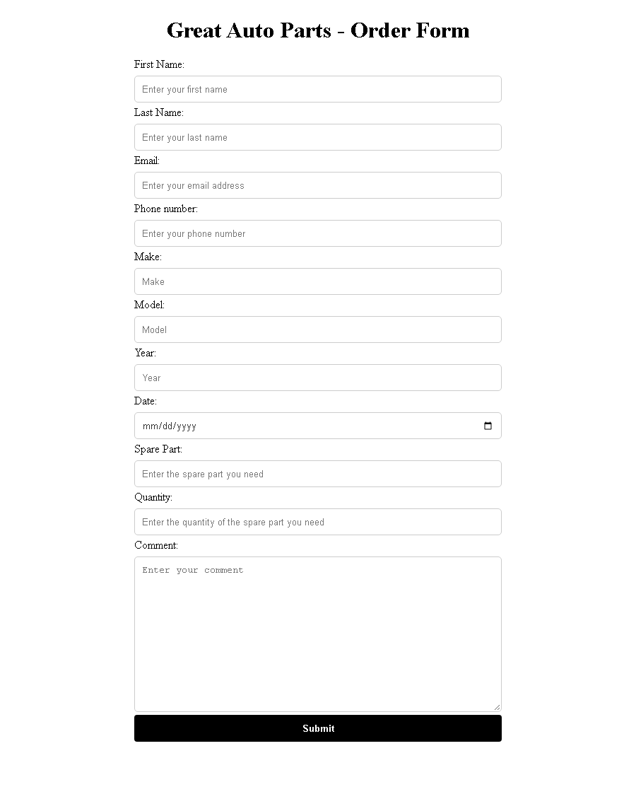

# CPIT-405 - Lab 4: CSS Structure and Properties

| | |
|---|---|
| **Student** | Fahad Alshehri |
| **ID** | 2338900 |
| **Course** | CPIT-405 |

## Task

Create an HTML form for placing an order to request auto parts and style it in CSS.

## Files

- `index.html` - the "Great Auto Parts - Order Form" page (first name, last name, email, phone number, make, model, year, date, spare part, quantity, comment, submit).
- `style.css` - the external stylesheet that styles the page.

## How to run

Open `index.html` in any web browser.

